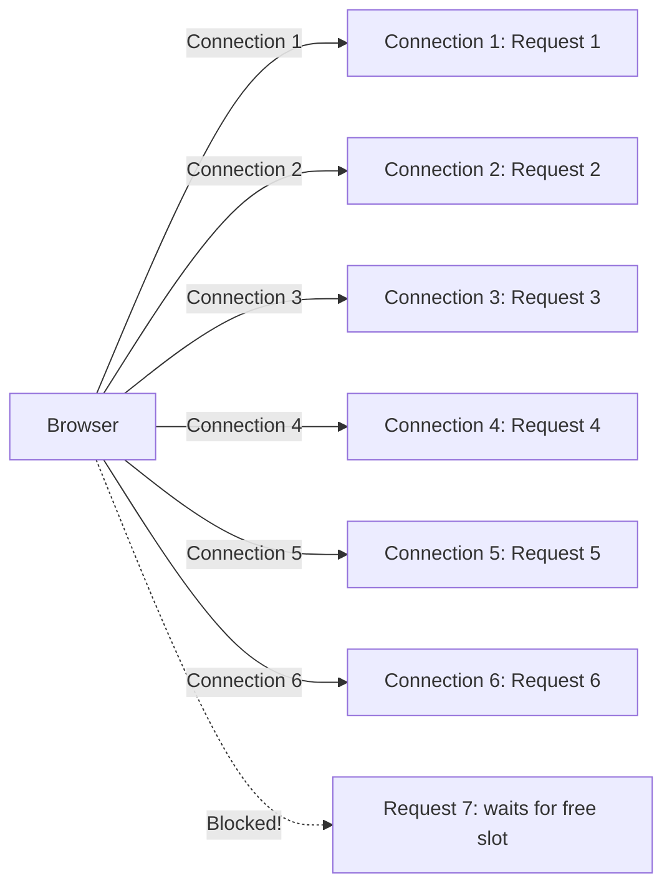
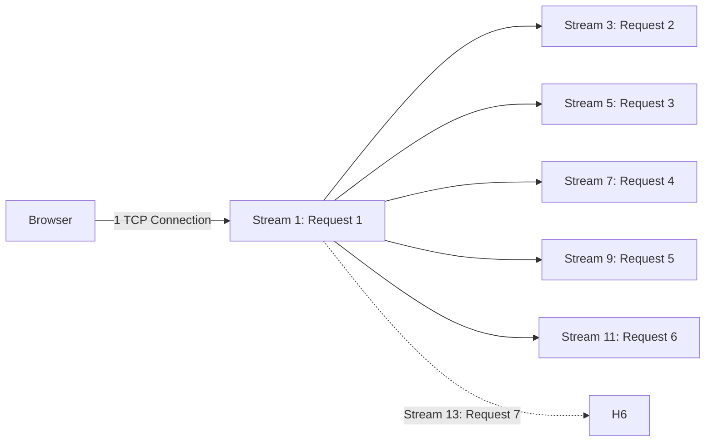
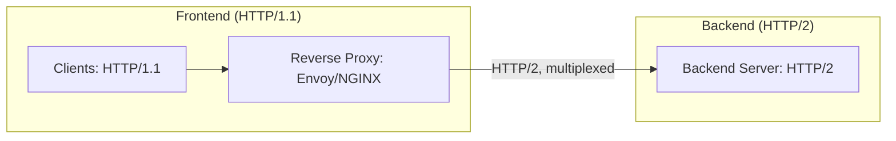

# Lecture 14: Multiplexing vs Demultiplexing (HTTP/2 Proxying vs Connection Pooling)

## Status: Complete

> ### 📋 Read this before continuing
>
> This lecture covers the distinction between **multiplexing** (combining N streams into 1 connection) and **demultiplexing** (routing 1 connection's interleaved frames back to N handlers). It then connects these concepts to **connection pooling**, which the transcript calls "glorified multiplexing" — a higher-layer technique that reuses pre-established connections instead of opening one per request.
>
> | Unit | Content |
> |---|---|
> | **1** | **Multiplexing** — combining multiple signals/requests into a single physical connection |
> | **2** | **Demultiplexing** — splitting a single connection's frames back to multiple handlers |
> | **3** | **Connection pooling** — reusing pre-established connections to avoid per-request connection cost |
> | **4** | **HTTP/1.1 vs HTTP/2** — browser-level comparison, 6-connection limit, and the blocking demo |
> | **5** | **Reverse proxy patterns** — HTTP/1.1 front, HTTP/2 backend, and where load appears |
> | **6** | **Trade-offs** — throughput vs CPU cost, independent flow control, head-of-line blocking |
> | **7** | **SQL pipelining** — why you normally need multiple connections for concurrent queries |
> | **8** | **Recap** — the unified mental model and three axes for classifying these patterns |

---

## Unit 1 — What is Multiplexing?

### Direct Answer

**Multiplexing** is the technique of combining multiple independent data streams or signals into a single physical channel (TCP connection, circuit, wire) for transmission, then separating them at the receiving end via demultiplexing. Each stream is tagged with an identifier so the receiver can route frames to the correct handler.

### Mental Model & Causal Reasoning

The fundamental problem multiplexing solves is **resource exhaustion**:

- Every TCP connection consumes: file descriptors, kernel buffer memory, CPU for connection state, TLS handshake overhead
- If every HTTP request requires its own TCP connection, a modern web page with 100+ resources would need 100+ connections — unsustainable

The causal chain:
1. Multiple requests/signals arrive at a sender
2. Each is assigned a stream identifier
3. All are serialized into one physical connection with framing headers
4. The receiver reads frames from the single connection
5. Uses the stream IDs to route each frame to the correct handler
6. Each handler reassembles its frames in order

### The elevator analogy

- **Without multiplexing:** Each person takes their own private elevator shaft. 3 people = 3 shafts. Wasteful.
- **With multiplexing:** One elevator, multiple people enter at different floors, ride together, exit at their floors. The shaft is shared, but each person's journey is independent and tracked by floor buttons.

### Example: HTTP/2 Multiplexing

A browser loads a page needing 3 resources: HTML, CSS, JS.

**HTTP/1.1 (no multiplexing):**
- Browser opens 3 TCP connections (or reuses 1, but serially)
- Request 1 → wait → Request 2 → wait → Request 3
- Or opens 6 parallel connections but each carries one request at a time

**HTTP/2 (multiplexing):**
- Browser opens 1 TCP connection
- Sends 3 requests concurrently as 3 separate streams (Stream IDs: 1, 3, 5)
- Server processes all 3 in parallel
- Responses come back on their respective stream IDs
- Frames from different streams can be interleaved on the wire

```
HTTP/2 Frame: [Stream ID: 1][HEADERS: GET /style.css]
HTTP/2 Frame: [Stream ID: 3][HEADERS: GET /app.js]
HTTP/2 Frame: [Stream ID: 5][DATA: ...]
HTTP/2 Frame: [Stream ID: 1][DATA: CSS content]
```

### What the Source Got Right

- "Many-to-one" = multiplexing (combining)
- "One-to-many" = demultiplexing (splitting)
- HTTP/1.1's 6-connection browser limit as motivation
- The CPU cost trade-off ("parsing requests from the same connection takes time")

### What the Source Missed

- Don't use "demultiplexing" to describe the reverse of HTTP/2 multiplexing to multiple HTTP/1.1 connections — that's just fanning out, not true demultiplexing.

---

## Unit 2 — What is Demultiplexing?

### Direct Answer

**Demultiplexing** is the reverse of multiplexing: taking a single incoming channel that carries multiple interleaved streams/frames and routing each stream to its correct destination handler. The receiver parses framing headers to extract stream identifiers, then dispatches each frame to the appropriate handler based on that identifier.

### Mental Model & Causal Reasoning

Demultiplexing is the **necessary counterpart** to multiplexing. Without it, multiplexing produces an undifferentiated byte stream that nobody can use. Demultiplexing requires **explicit framing metadata** embedded in the data stream — frame headers with stream/channels IDs that say "this frame belongs to stream X."

The causal chain:
1. Sender embeds stream identifiers in frame headers
2. Sender interleaves frames from multiple streams on one physical connection
3. Receiver reads the byte stream from the connection
4. Receiver parses frame headers to extract the stream ID
5. Receiver routes each frame to the correct stream's handler
6. Each stream handler reassembles its frames in order and processes the complete message

### The CPU cost (hidden in the transcript)

The transcript mentions that multiplexing puts load on the CPU because "the CPU needs to stop parsing this request from different from the same connection." This is **demultiplexing in action**:

The server must:
- Parse frame headers on every incoming frame
- Maintain per-stream state (header tables, buffers, handlers)
- Switch context between streams as interleaved frames arrive
- Reassemble fragmented DATA frames in order
- Detect and handle stream errors independently

This is significantly more CPU-intensive than HTTP/1.1's simple "read request → process → write response" model.

### Example: HTTP/2 Demultiplexing

The server receives a single TCP connection carrying interleaved frames:

```
[Stream 1][HEADERS: GET /api/users]
[Stream 3][HEADERS: POST /api/orders]
[Stream 1][DATA: ...]
[Stream 5][HEADERS: GET /api/products]
[Stream 3][DATA: ...]
[Stream 1][HEADERS: 200 OK]
[Stream 3][DATA: ...]
[Stream 1][DATA: JSON response]
```

The HTTP/2 server's demultiplexer:
1. Reads each frame from the TCP stream
2. Extracts the stream ID from the frame header
3. Routes the frame to the correct stream's handler:
   - Stream 1 → reassembles into a complete request for /api/users
   - Stream 3 → reassembles into a complete POST /api/orders
   - Stream 5 → reassembles into a complete GET /api/products
4. Each handler processes independently — concurrent, not sequential

---

## Unit 3 — What is Connection Pooling?

### Direct Answer

**Connection pooling** is a caching technique where pre-established connections to a backend (database, API, service) are maintained in a pool and reused across multiple requests. Instead of creating a new connection for each request, the requester borrows an idle connection from the pool, uses it, and returns it.

### Mental Model & Causal Reasoning

Creating a connection is expensive:
- **TCP handshake:** 3 packets (SYN, SYN-ACK, ACK) — at least 1 RTT
- **TLS handshake (if HTTPS):** Multiple RTTs, certificate validation, key exchange
- **Authentication:** Some connections require login per connection (database, SMTP)
- **Server-side setup:** Server allocates memory, file descriptors, session state

If every request creates a new connection, latency and overhead scale linearly. Connection pooling **amortizes** this cost across many requests.

The causal chain:
1. Application starts → pool opens M connections to backend → keeps them warm
2. Request arrives → pool assigns an idle connection
3. Request handler uses the connection → gets response → returns it to pool
4. Next request → repeat, reusing a warm connection

### Why not just one connection?

The transcript raises this: "Why can't I send multiple SQL queries on the same connection?" The answer is **protocol-dependent**:

- **Without pipelining (most databases, HTTP/1.1):** Send one request → wait for response → send next. Strictly sequential.
- **With pipelining (Postgres 14+, HTTP/2):** Send multiple requests, get responses in order. Still sequential processing, not true parallelism.

A single connection can only serve one request at a time. To serve concurrent requests, you need multiple connections — hence the pool.

### The transcript's example

A PostgreSQL server with a pool of 4 connections:

```
Connections: [Conn 1: busy] [Conn 2: busy] [Conn 3: busy] [Conn 4: busy]

Request 5 arrives → all connections busy → BLOCKED until a connection frees up

When Request 1 completes → Conn 1 returns to pool → Request 5 can proceed
```

### Connection Pooling = Glorified Multiplexing

| Concept | Multiplexing | Connection Pooling |
|---------|-------------|-------------------|
| **Input** | N logical streams | N requests |
| **Channel** | 1 physical connection | M physical connections (pool) |
| **Routing** | Frame headers with stream IDs | Pool manager picks an idle connection |
| **Goal** | Serve many requests on few connections | Serve many requests on pre-warmed connections |
| **Layer** | Transport/protocol layer | Application layer |

**The relationship:**
- **Multiplexing (HTTP/2):** One connection, many streams, protocol-level routing via stream IDs
- **Connection pooling:** Many connections, application-level routing via pool manager, no stream identifiers
- Both solve the same fundamental problem: serve many requests without paying connection establishment cost per request
- Connection pooling is a form of multiplexing — it multiplexes requests onto a fixed set of connections, just at a higher layer with less protocol-level sophistication

### What the Source Got Right

- "Glorified multiplexing" — accurate characterization
- "Pick a free connection" model — correct
- Pool exhaustion blocking scenario — well demonstrated
- The Django single-connection-per-thread limitation example

### What the Source Missed

- **Connection validation:** pooled connections may go stale (server timeout, network drop); good pools validate before handing out
- **Error handling:** what happens when a pooled connection fails mid-request — needs retry logic, connection replacement
- **Tuning:** pool size must match concurrency level and backend capacity. Too large → resource waste. Too small → exhaustion and blocking.

---

## Unit 4 — HTTP/1.1 vs HTTP/2: The Browser Connection Limit

### HTTP/1.1: The 6-Connection Bottleneck

HTTP/1.1 can only multiplex at the **connection level**, not the **stream level**. The browser default opens up to 6 connections per origin domain.



Each connection carries exactly one request at a time. This is **not multiplexing** — it's **parallelism at the connection level**.

### HTTP/2: Single Connection, Many Streams

HTTP/2 multiplexes at the **stream level** over a single TCP connection:



All 7 requests can be in flight simultaneously on one connection.

### The blocking demo from the transcript

The transcript demonstrates what happens when long-polling exhausts the HTTP/1.1 connection pool:

**Setup:** Long-polling endpoints that hold connections open until a job completes.

**Process:**
1. User submits jobs via long-polling
2. Each job occupies a browser connection (connections 1-6 fill up)
3. Job 7 tries to submit → no free connections → **BLOCKED**
4. User cannot submit new jobs until existing long-polls complete
5. Waterfall visualization shows requests stalled for 1.2 minutes

**Key observation:** "Nobody's ever actually unblock the client side" — the browser doesn't attempt new connections beyond the 6-connection limit.

### The 6-connection numbers

The transcript notes that connection IDs in the browser's network tab repeat — 5353, 11, 92, 47, 49 — confirming that Chrome reuses connections rather than opening new ones. "Reusability is really important here for Chrome to not exceed that six hard number."

### What the Source Got Right

- The 6-connection limit and its origin in browser behavior
- The blocking scenario with long-polling
- The waterfalled requests visualization
- Connection reuse rather than new connections beyond the limit

### What the Source Missed

- HTTP/1.1 does have **request pipelining** (sending multiple requests without waiting for responses), but it's rarely used and doesn't solve the problem (head-of-line blocking)
- HTTP/2 multiplexing has a different head-of-line blocking problem at the TCP layer (one lost packet blocks all streams)

---

## Unit 5 — Reverse Proxy Patterns: HTTP/1.1 Frontend, HTTP/2 Backend

### The topology from the transcript



### How it works

1. **Front-end:** Clients establish HTTP/1.1 connections to the proxy (each client gets its own TCP connection)
2. **Proxy to backend:** Proxy establishes a single HTTP/2 connection to the backend server
3. **Multiplexing:** The proxy multiplexes all client requests onto the single HTTP/2 connection as separate streams

**Client A** sends 3 requests over 3 HTTP/1.1 connections  
**Client B** sends 2 requests over 2 HTTP/1.1 connections  
**Proxy** multiplexes all 5 requests as 5 streams on 1 HTTP/2 connection to backend

### The advantage

- Fewer connections to the backend (one HTTP/2 connection per proxy, not one per client request)
- Better resource utilization on the backend
- Backend can process requests in parallel via streams

### The trade-off the transcript notes

> "You get more throughput but at the cost of more resources here"

- **Throughput:** Better — the backend processes 5 requests concurrently on one connection
- **CPU:** Higher — the backend must demultiplex 5 streams on one connection (CPU cost of frame parsing)
- **Memory:** Lower connection count, but more per-stream buffer state

### The flip: demultiplexing at the proxy

When the backend sends responses:
- Stream 1 → response for Client A, Request 1
- Stream 3 → response for Client B, Request 1
- etc.

The proxy **demultiplexes** each response frame to the correct HTTP/1.1 connection.

---

## Unit 6 — Trade-offs and Limitations

### Multiplexing trade-offs

**Advantages:**
1. **Fewer connections** → less memory, fewer file descriptors, lower handshake overhead
2. **Better throughput** → no head-of-line blocking at the application layer
3. **Improved latency** → requests don't wait for a connection to free up
4. **TCP efficiency** → one congestion control window, one TLS handshake amortized

**Limitations:**
1. **CPU overhead** → 2-5x more CPU for frame parsing, stream state management, context switching
2. **Head-of-line blocking at TCP layer** → a single lost TCP packet blocks ALL streams on that connection until TCP retransmission
3. **Complexity** → stream priority, flow control, error handling across streams add complexity
4. **Resource contention** → all streams share one connection's bandwidth; one greedy stream can starve others

### Connection pooling trade-offs

**Advantages:**
1. **Reduced latency** → no TCP/TLS handshake per request (saves 1-RTT per request)
2. **Lower server load** → fewer connections means less memory, file descriptors
3. **Better throughput** → requests don't wait for connection establishment
4. **Resource predictability** → pool size caps maximum connections

**Limitations:**
1. **Pool exhaustion** → if all connections are busy, new requests block or fail
2. **Stale connections** → connections may time out or drop; pool must validate or recover
3. **Idle waste** → idle connections still consume server resources
4. **Configuration complexity** → pool size must be tuned per workload

### The independent flow control trade-off

The transcript says:

> "It's really good to have each request goes into its own connection because it will have its own rules and flow control and congestion control. So they are not affecting each other."

This is a **key trade-off** not fully explored:

- **Multiplexed (HTTP/2):** All streams share one connection's flow control and congestion window. A burst on stream 1 can starve streams 3, 5, 7. HTTP/2 has per-stream flow control, but not per-stream congestion control.

- **Pooled (HTTP/1.1):** Each connection has independent flow control and congestion control. A burst on connection 1 doesn't affect connection 2. This is true isolation.

**QUIC/HTTP/3** solves this by having per-stream congestion control at the transport layer.

### Head-of-line blocking across layers

| Layer | Multiplexing problem | Solution |
|-------|---------------------|----------|
| Application (HTTP/1.1) | One request blocks the connection | Open parallel connections |
| Application (HTTP/2) | One slow response blocks other streams on same connection | Per-stream flow control |
| Transport (TCP) | One lost packet blocks ALL streams on connection | QUIC/HTTP/3 (per-stream reliability) |

---

## Unit 7 — SQL Pipelining and Why Multiplexing Isn't Always Used

### The transcript's SQL example

> "Why can't I send multiple SQL queries on the same connection? ... Let's say I send SQL one, two, three. SQL one takes 7 seconds. SQL three finishes first. How does the back end know the response we just got is for SQL two and not SQL one?"

### The problem: no stream identifiers in the protocol

Most database query protocols (MySQL, older Postgres) and HTTP/1.1 are **strict request-response**:

1. Client sends Request 1
2. Server processes Request 1 completely
3. Server sends Response 1
4. Client reads Response 1
5. Client sends Request 2 → repeat

**No stream IDs, no interleaving, no pipelining (in most cases).** The protocol enforces ordering through its state machine.

### Pipelining: the partial solution

**PostgreSQL 14+** supports pipelining for prepared statements:

```sql
-- Client sends three queries without waiting for responses
BEGIN;
SELECT * FROM users WHERE id = 1;
SELECT * FROM orders WHERE user_id = 1;
SELECT * FROM products WHERE id = 5;
COMMIT;

-- Server sends three responses in the same order
-- Result 1 (users)
-- Result 2 (orders)  
-- Result 3 (products)
```

**Limitations:**
- Responses must come back in the **same order** as requests (no parallelism)
- A slow query still blocks subsequent query responses (head-of-line blocking)
- Not all database operations support pipelining

### Why databases don't fully multiplex

The transcript correctly identifies the core issue: **the protocol doesn't tag responses with request IDs**. To fix this:

```sql
-- Hypothetical tagged queries:
SELECT /* query_id: 7721 */ * FROM users WHERE id = 1;
SELECT /* query_id: 7722 */ * FROM orders WHERE user_id = 1;

-- Server responds:
-- [query_id: 7722] {orders data}
-- [query_id: 7721] {users data}
```

This would enable true multiplexing (responses in any order). But:
- Changes the protocol (backward incompatible)
- Requires server-side correlation tracking
- Most databases were designed around strict sequential semantics

### The connection pool workaround

Instead of multiplexing on one connection, **connection pooling multiplexes across many connections**:

```
Pool: [Conn 1] [Conn 2] [Conn 3] [Conn 4]

Request A (slow query) → Conn 1 (blocks, but only Conn 1)
Request B (fast query) → Conn 2 (unaffected, runs in parallel)
```

This gives **isolation** — slow queries don't affect unrelated fast queries.

### The trade-off

| Approach | Query A slow | Query B fast | Isolation | Connection cost |
|----------|-------------|-------------|-----------|-----------------|
| Single connection (no pool) | A blocks B | B waits for A | None | 1 connection |
| Connection pool | A on Conn 1, B on Conn 2 | B runs in parallel | Full | 2+ connections |
| Multiplexed (tagged responses) | A and B both served | B runs in parallel | Full | 1 connection |

---

## Unit 8 — The Unified View: When to Multiplex vs When to Pool

### The decision matrix

| Scenario | Multiplexing (HTTP/2) | Connection Pooling (HTTP/1.1) |
|----------|----------------------|------------------------------|
| **Browser-to-server** | HTTP/2 — one connection, many streams | HTTP/1.1 — 6 connections, parallelism |
| **Proxy-to-backend** | HTTP/2 backend — multiplexed from many clients | HTTP/1.1 backend — pooled connections per client |
| **App-to-database** | Rare (Postgres 14+ pipelining) | Pooled connections |
| **Service-to-service** | gRPC (HTTP/2 based) or HTTP/2 | HTTP/1.1 with pooling |

### The layered approach

In practice, systems use **both**:

```
Browser
  ↓ HTTP/2 (multiplexed)
CDN / Load Balancer  
  ↓ HTTP/1.1 (pooled)  
Reverse Proxy
  ↓ HTTP/2 (multiplexed)
App Server
  ↓ pooled connections
Database
```

Each layer optimizes for its context:
- **Browser layer:** Multiplexing avoids the 6-connection limit
- **Proxy layer:** Pool connections to the backend for efficiency
- **Connection to database:** Pool connections since databases often don't support true multiplexing

### The three axes of classification

| Pattern | Axis 1: Who multiplexes | Axis 2: Where? | Axis 3: Trade-off |
|---------|------------------------|----------------|--------------------|
| **HTTP/2** | Protocol (stream IDs in frames) | Single connection | Throughput vs CPU on frame parsing |
| **Connection Pool** | Application (pool manager) | Multiple connections | Latency vs pool size tuning |
| **HTTP/1.1** | Browser (parallel connections) | Multiple connections | Parallelism vs connection limit (6) |

---

## Recap: The One-Sentence Trade

> **Multiplexing trades CPU complexity for connection efficiency. Connection pooling trades resource management complexity for latency.**

The transcript correctly identifies this tension:

> "It's really it's really good to have each request goes into its own connection because it will this will have its own rules and flow control and congestion control."

This is the **independence** argument — each connection has isolated state. Multiplexing gives up that isolation for efficiency.

---

## What the Source Got Wrong or Oversimplified

| Claim | Issue | Correction |
|-------|-------|------------|
| "Connection pool is just glorified multiplexing" | True but undersold | Pooling multiplexes across connections (application layer), HTTP/2 multiplexes within connections (protocol layer). Different tools for different jobs. |
| SQL "you can't send multiple queries on same connection" | Mostly true historically | PostgreSQL 14+ supports pipelining. But still has head-of-line blocking (ordered responses). |
| "Each request goes into its own connection → independent flow control" | Presented as purely good | True for isolation, but costs more connections. The right answer depends on workload: predictable queries → pool; unpredictable → multiplex. |
| No mention of HTTP/2 TCP-level HOL blocking | Missing context | HTTP/2 solves application-layer HOL blocking but reintroduces it at TCP layer. This is why QUIC exists. |

---

## Open Questions Carried Forward

| # | Question | Why it matters |
|---|----------|---------------|
| 1 | **HTTP/3/QUIC** | HTTP/2's TCP-level head-of-line blocking — solved by QUIC's per-stream congestion control at transport layer |
| 2 | **gRPC multiplexing** | gRPC uses HTTP/2 — how does its stream model differ from HTTP/2's? |
| 3 | **Proxy buffering** | Does the reverse proxy (Envoy) buffer multiplexed responses? How does this change latency characteristics? |
| 4 | **Pool sizing for HTTP/2** | If HTTP/2 multiplexes, does the backend still need connection pooling for database connections? How do these two layers interact? |

*Documented after studying the transcript and cross-referencing against HTTP/2 specification (RFC 7540), PostgreSQL 14 pipelining docs, and established networking knowledge. Claims about CPU overhead and head-of-line blocking verified against standard references.*
